# win16rt: Creative Writer y Fine Artist, nativos en Linux

**Un entorno de ejecución nativo para Linux de los programas infantiles de Microsoft de los años 90, _Creative Writer_ y
_Fine Artist_.** Carga los ejecutables originales de Windows 3.1 sin modificarlos y los ejecuta sin Wine, sin máquina
virtual y sin Windows.

[Read in English](README.md)


-008080)


[](https://www.youtube.com/watch?v=8K5z4S8xA_M)

_Haz clic en la imagen para ver el video en YouTube._

## Contenido

1. [Qué es](#qué-es)
2. [Qué programas y versiones funcionan](#qué-programas-y-versiones-funcionan)
3. [Un recorrido por orden de aparición](#un-recorrido-por-orden-de-aparición)
4. [El software lo pones tú: dónde conseguirlo](#el-software-lo-pones-tú-dónde-conseguirlo)
5. [Inicio rápido](#inicio-rápido)
6. [Características](#características)
7. [Qué hizo falta para correrlo en Fedora 44](#qué-hizo-falta-para-correrlo-en-fedora-44)
8. [Compilar desde el código fuente](#compilar-desde-el-código-fuente)
9. [Dónde se guardan tus archivos](#dónde-se-guardan-tus-archivos)
10. [Empaquetado: .run portátil, AppImage, Flatpak, deb, rpm](#empaquetado-run-portátil-appimage-flatpak-deb-rpm)
11. [Notas de preservación del software](#notas-de-preservación-del-software)
12. [Limitaciones conocidas](#limitaciones-conocidas)
13. [Pruebas y contribuciones](#pruebas-y-contribuciones)
14. [Hoja de ruta](#hoja-de-ruta)
15. [Créditos y licencias](#créditos-y-licencias)
16. [Nota legal](#nota-legal)

## Qué es

`cwfa` es un intérprete escrito en C. Lee los `.EXE` y `.DLL` originales de Windows de 16 bits (formato NE) y los ejecuta:

* un **intérprete de CPU x86 de 16 bits en modo protegido** (con unidad de coma flotante x87 y la interfaz del emulador `WIN87EM`),
* una **reimplementación en C de la API Win16** (KERNEL, USER, GDI, MMSYSTEM, TOOLHELP, VER y lo demás que llaman los
  programas), una capa de «emulación de alto nivel»: cuando el programa llama a una función de Windows, responde nuestro código C,
* una **ventana SDL2** (una imagen de 640x480 en 256 colores, escalable y con barras negras) y audio SDL2.

**No** es Wine, **no** es un emulador de sistema completo y **no** necesita Windows ni una licencia de Windows. Solo implementa lo
que estos dos programas necesitan, así que es pequeño (el paquete portátil pesa unos 3 MB).

**Este repositorio no contiene software de Microsoft.** No hay ISO, ni archivos `.EXE`/`.DLL` de los programas, ni sonidos,
imágenes o documentos suyos. Tú aportas tu copia del disco (ver más abajo). El único código y datos de terceros incluidos son las
fuentes Liberation y `stb_truetype.h`, con sus propias licencias libres (ver [Créditos y licencias](#créditos-y-licencias)).

## Qué programas y versiones funcionan

Los dos programas pueden usarse juntos (como en el CD combinado, cambiando de uno a otro) o cada uno por separado.

| Edición | Medio | Estado |
|---|---|---|
| **Creative Writer + Fine Artist 1.1a, inglés** (CD combinado, etiqueta de ISO `CWFA110__01`) | CD-ROM | Ambos programas funcionan de principio a fin (ver abajo) |
| **Creative Writer, inglés, por separado** | CD-ROM / disquetes | Sin probar: solo se dispuso del CD combinado 1.1a. El entorno carga un programa por proceso, así que una edición independiente debería funcionar si sus archivos coinciden; no está verificado |
| **Fine Artist, inglés, por separado** | CD-ROM / disquetes | Sin probar, igual que el anterior |
| **Creative Writer 1.0, español** (*Creative Writer*) | Estructura de CD o imágenes de disquete, con archivos comprimidos en el formato KWAJ de Microsoft | Funciona de principio a fin |
| **Fine Artist 1.0, español** (*Fine Artist*) | Cuatro disquetes (`DISCO1`..`DISCO4`) | Funciona de principio a fin |

«De principio a fin» significa: cada sesión se condujo sin ventana con entradas programadas, con capturas revisadas por una
persona y cubiertas por las pruebas automáticas: inicio de sesión («¿quién eres?», con acentos escritos en español), la historia
de la primera vez hasta el mapa de Imaginópolis, el estudio de escritura y el de pintura (texto, pincel, bote de pintura,
pegatinas), guardar un documento, salir, reabrir el trabajo guardado e imprimir a PDF. Las capturas de esas ejecuciones están en
[`docs/screenshots/`](docs/screenshots/). Lo que **no** se ha verificado está en
[Limitaciones conocidas](#limitaciones-conocidas).

Los programas del lado Macintosh de los discos (el CD 1.1a incluye también una versión Macintosh m68K) no se usan: esto
ejecuta los programas de Windows.

## Un recorrido por orden de aparición

Lo que verás, pantalla por pantalla, desde que arranca un programa. Son capturas de los programas originales ejecutándose en nuestro runtime (ejecuciones sin ventana, 640x480, con un usuario nuevo llamado «Ana»). Los dos programas comparten la misma ciudad; cada uno tiene su propio edificio.

### Creative Writer (inglés)
| **1.** Pantalla de inicio | **2.** ¿Quién eres? (McZee pide tu nombre) | **3.** Imaginópolis | **4.** El edificio (el verde es el de Writer) |
|:---:|:---:|:---:|:---:|
| 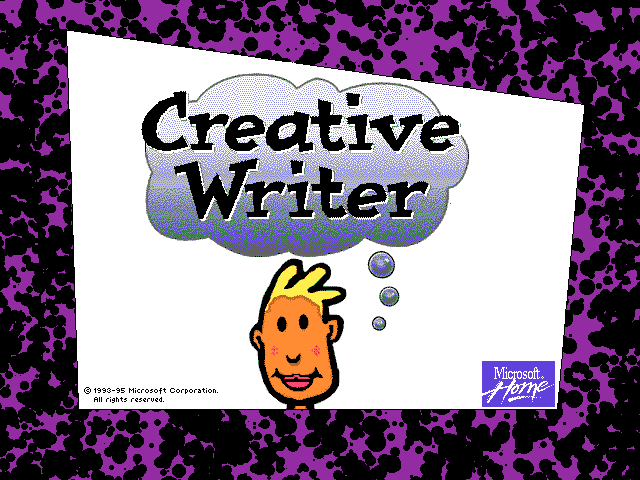 | 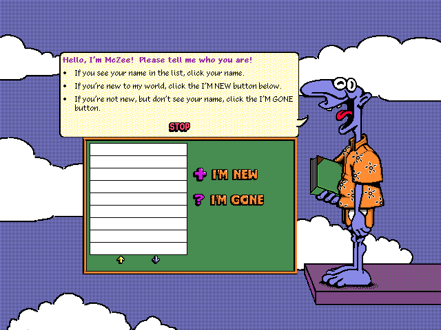 |  | 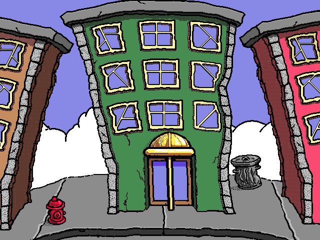 |
| **5.** Selección de nivel: el vestíbulo, con la lista de plantas arriba a la izquierda | **6.** Una planta: el Idea Workshop |  |  |
| 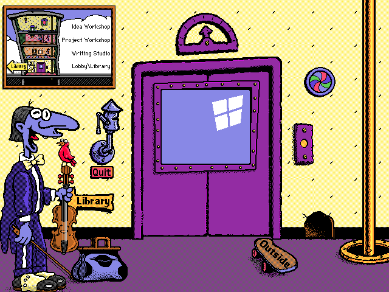 | 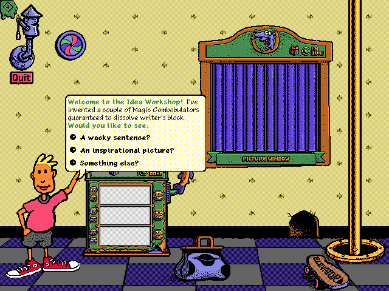 |  |  |

### Fine Artist (inglés)
| **1.** Pantalla de inicio | **2.** ¿Quién eres? (McZee pide tu nombre) | **3.** Imaginópolis | **4.** El edificio (el rosa es el de Artist) |
|:---:|:---:|:---:|:---:|
| 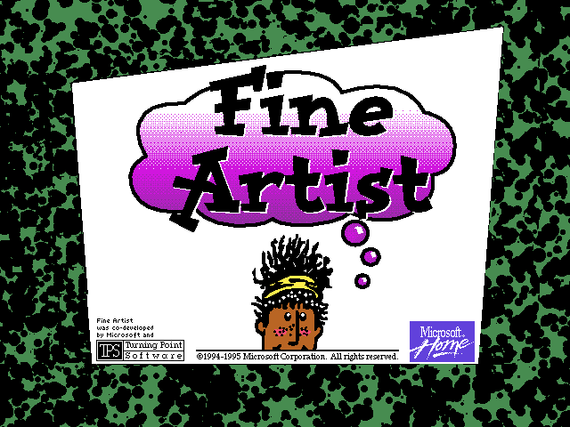 | 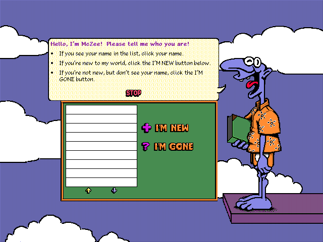 |  | 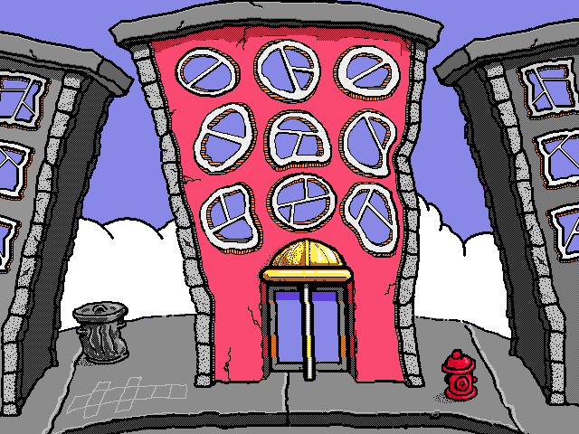 |
| **5.** Selección de nivel: el vestíbulo, con la lista de plantas arriba a la izquierda | **6.** Una planta: Drawing Tricks |  |  |
| 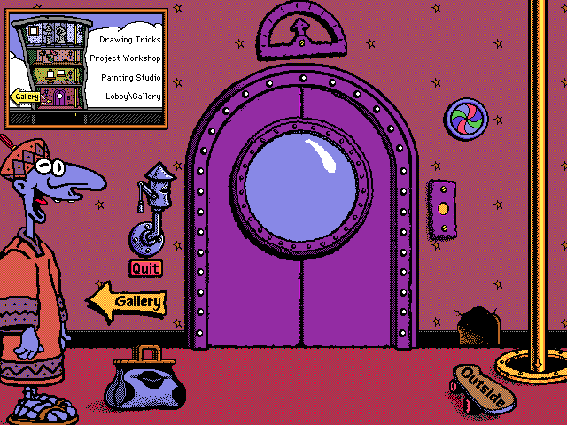 | 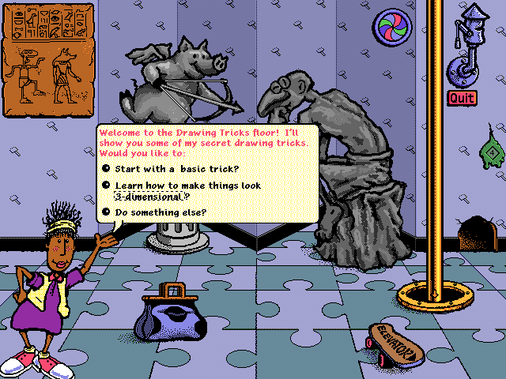 |  |  |

### Creative Writer (español)
| **1.** Pantalla de inicio | **2.** ¿Quién eres? | **3.** Imaginópolis | **4.** El edificio |
|:---:|:---:|:---:|:---:|
| 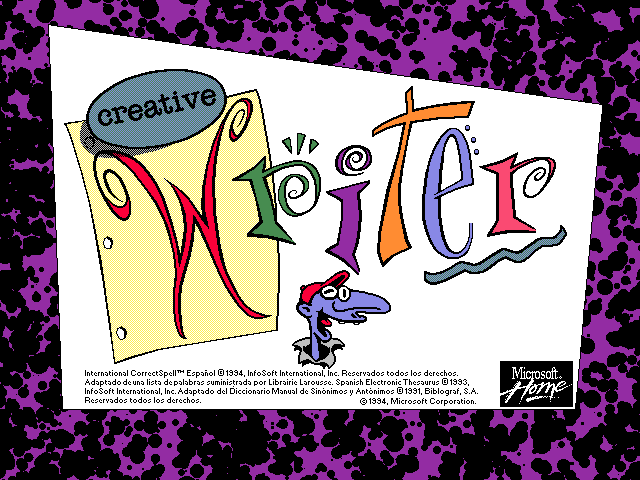 | 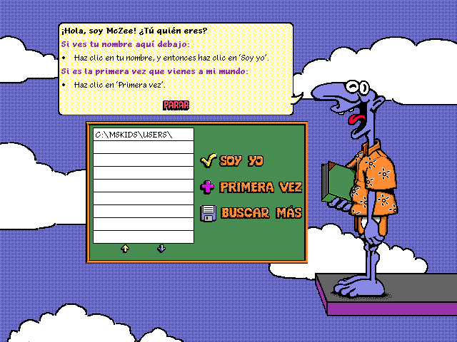 |  |  |
| **5.** Selección de nivel: el vestíbulo, con la lista de plantas («Taller de ideas», «Taller de proyectos», ...) | **6.** Una planta: el Taller de ideas |  |  |
| 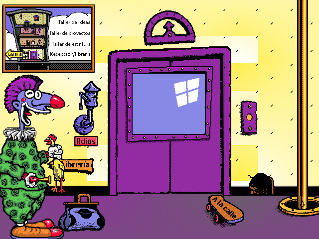 | 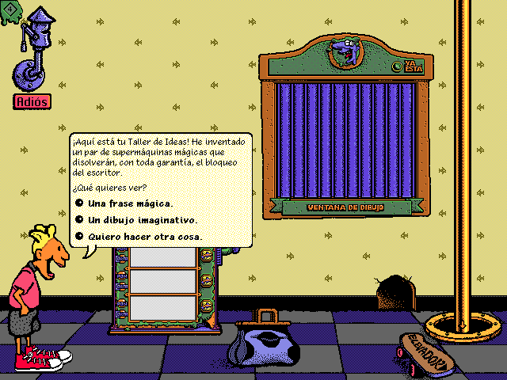 |  |  |

### Fine Artist (español)
| **1.** Pantalla de inicio | **2.** ¿Quién eres? | **3.** Imaginópolis | **4.** El edificio |
|:---:|:---:|:---:|:---:|
| 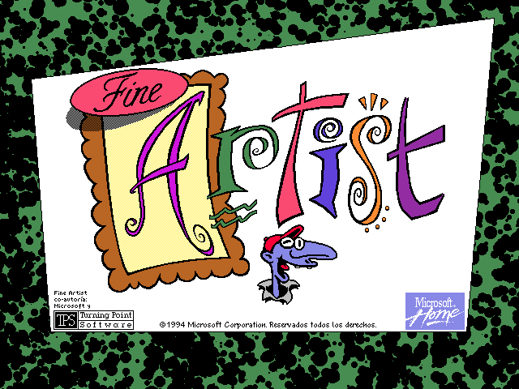 | 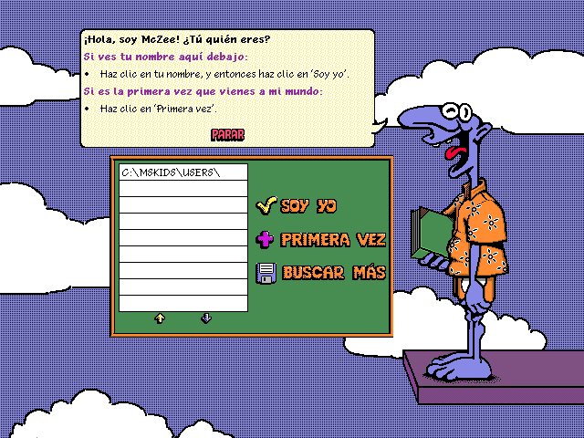 |  |  |
| **5.** Selección de nivel: el vestíbulo, con la lista de plantas («Trucos de dibujo», «Taller de proyectos», ...) | **6.** Una planta: Trucos de dibujo |  |  |
| 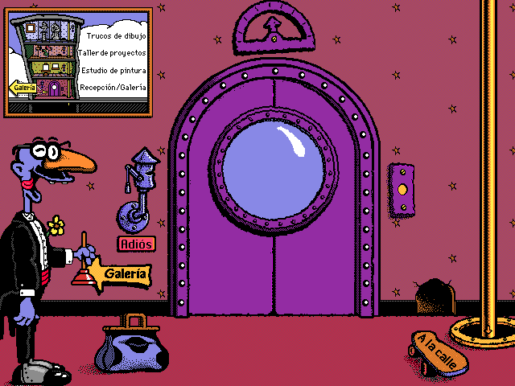 | 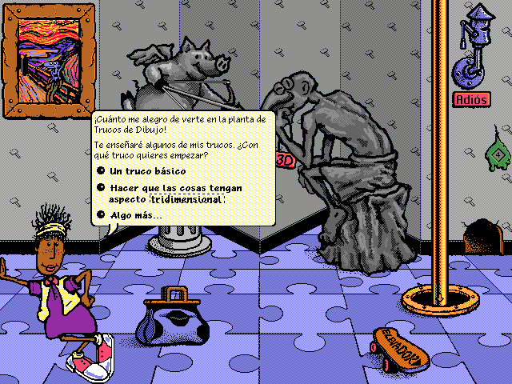 |  |  |

## El software lo pones tú: dónde conseguirlo

Los programas son de Microsoft y aquí no se distribuyen. Copias conservadas por archivistas:

* **WinWorld**, Creative Writer 1.x: <https://winworldpc.com/product/microsoft-creative-writer/1x>. Lista las versiones 1.x,
  incluida la 1.1a (el CD combinado Creative Writer + Fine Artist), e indica que existen ediciones en español y sueco de la 1.0.
* **Internet Archive**, Creative Writer (CD-ROM para Windows 3.1 y Macintosh, 1994, Microsoft Kids):
  <https://archive.org/details/creative-writer>.
* **Libro** sobre el programa: [_Exploring Creative Writer_](https://archive.org/details/exploringcreativ0000kurs), ver
  [el libro](#el-libro-exploring-creative-writer) más abajo.

Comprueba que puedes usar estos archivos donde vives: ver la [nota legal](#nota-legal). Los medios en español usados durante el
desarrollo fueron una imagen de CD de Creative Writer 1.0 y los disquetes de Fine Artist.

## Inicio rápido

Necesitas la imagen del CD (`.ISO`) o su contenido extraído en una carpeta.

### Opción A: instalarlo para tu usuario (recomendado)

```sh
scripts/install.sh --cd /ruta/a/CWFA110__01.ISO        # genera el paquete portátil y lo instala por ti
# lo mismo desde el paquete:  ./dist/cwfa-portable-x86_64.run --install --cd /ruta/a/CWFA110__01.ISO
# con las ediciones en español: añade --es-cd /ruta/al/creative-writer-es  --es-fa-cd /ruta/al/fine-artist-es
```

Creative Writer y Fine Artist aparecen entonces en el lanzador de aplicaciones (Actividades de GNOME, la cuadrícula de apps), cada
uno con su icono; las ediciones en español tienen su propia entrada cuando indicas sus medios. Ábrelos desde ahí o con
`cwfa-launch writer|artist|es-writer|es-artist`. No hace falta root: todo queda dentro de tu carpeta personal.

* **El CD:** `--cd` es opcional. Si lo omites, el primer arranque pregunta dónde está el CD (o la `.ISO`), con un cuadro de diálogo
  si tienes `zenity` y en la terminal si no, y recuerda la respuesta en `~/.config/cwfa/media.conf`.
  `cwfa-launch --configure` lo cambia después (`--cd`, `--es-cd`, `--es-fa-cd`).
* **Iconos:** la edición inglesa en CD dibuja un CD en los iconos de los programas (cesto verde con lápiz para Creative Writer,
  cesto magenta-rosa con pincel para Fine Artist); las ediciones en español llevan el mismo dibujo **sin** el CD. Las entradas del
  lanzador usan el dibujo sin CD de las ediciones en español cuando hay medios en español configurados, y el icono propio de cada
  programa en caso contrario (`--icons original|plain|auto`). Los iconos se hacen con tus propios medios; no se distribuyen.
* **Solo español:** cuando solo hay medios en español configurados (sin disco inglés en `media.conf`), el menú muestra los programas
  en español simplemente como «Creative Writer» y «Fine Artist», no se crea ninguna entrada en inglés, y las entradas en inglés que
  instala un paquete (el RPM) quedan ocultas para ti con un archivo del mismo nombre y `Hidden=true` en
  `~/.local/share/applications` (solo mientras esas entradas en inglés estén instaladas; con el paquete `cwfa-spanish` solo, no hay
  nada que ocultar y se quita cualquier archivo sobrante). Al configurar de nuevo un disco inglés se quitan y vuelve el sufijo «(Español)».
* **Desinstalar:** `cwfa-launch --uninstall` (o `scripts/install.sh --uninstall`) borra exactamente lo instalado, registrado en
  `~/.local/share/cwfa/install.manifest`. Tus usuarios y documentos se quedan en `~/.local/share/cwfa/data`; `--purge --yes` los
  borra también (sin `--yes` pregunta, y sin terminal se niega).
* Instalar de nuevo actualiza en el mismo sitio.

### Opción B: el paquete portátil

```sh
scripts/package.sh                                           # genera dist/cwfa-portable-x86_64.run
./dist/cwfa-portable-x86_64.run writer --cd /ruta/a/CWFA110__01.ISO
./dist/cwfa-portable-x86_64.run artist --cd /ruta/a/CWFA110__01.ISO
```

`--cd` acepta la `.ISO` (se extrae una vez en `~/.local/share/cwfa/cd/`, con `7z`, `bsdtar` o `isoinfo`) o una carpeta.
Para los discos en español, indica la carpeta que contiene `INSTALAR.LST` (Creative Writer) o las carpetas `DISCO1`..`DISCO4`
(Fine Artist): se detectan solas.

### Opción C: desde una copia del repositorio

```sh
make                                          # necesita gcc, make y los archivos de desarrollo de SDL2
scripts/play.sh writer|artist|es-writer|es-artist [opciones]
```

`play.sh` espera los archivos originales en `reference/` (ignorada por git): `reference/WRITER.EXE`, `reference/ARTIST.EXE`,
`reference/cd/` (el contenido del CD) y, para español, `reference/es_nrg1` y `reference/es_fa/...`.

### Opción D: un RPM (Fedora y derivadas)

```sh
scripts/build-rpm.sh                                       # o: make rpm; compila desde el árbol confirmado en build/rpm/
sudo dnf install build/rpm/RPMS/x86_64/cwfa-[0-9]*.rpm build/rpm/RPMS/x86_64/cwfa-spanish-*.rpm      # el runtime y las ediciones en español en el menú
sudo dnf install build/rpm/RPMS/x86_64/cwfa-[0-9]*.rpm build/rpm/RPMS/x86_64/cwfa-english-*.rpm      # ... o las ediciones en inglés (se pueden instalar las dos)
```

De un solo spec salen tres paquetes:

| Paquete | Contiene |
|---|---|
| `cwfa` | el runtime en `/usr/libexec/cwfa` y el comando `cwfa-launch` en `/usr/bin`, con la documentación y la licencia; sin entradas de menú |
| `cwfa-english` | las entradas de menú y los datos AppStream de Creative Writer y Fine Artist (ediciones en inglés), con un icono genérico |
| `cwfa-spanish` | lo mismo para las ediciones en español, listadas simplemente como «Creative Writer» y «Fine Artist» |

Instala `cwfa` junto con la edición que tengas; cada paquete de edición necesita el runtime, y el runtime no necesita ninguno. Los
paquetes no contienen datos del juego ni fuentes: necesitan los paquetes de fuentes Liberation. Se quitan desde GNOME Software o con
`sudo dnf remove cwfa-spanish` (o `cwfa-english`, o `cwfa` para todo). El primer arranque de cada programa
pide el CD como en la opción A y crea en tu carpeta personal los iconos reales del programa.
*Verificado aquí:* el paquete se construye, se inspeccionaron su contenido y sus dependencias, y los archivos de escritorio y AppStream
validan. Se instaló con `dnf` en Fedora 44 (GNOME, Wayland) y Creative Writer en español se abrió desde el menú de aplicaciones,
con los iconos propios de los programas (sin CD) y los nombres simples «Creative Writer» y «Fine Artist».
*Sin verificar:* verlo y quitarlo desde GNOME Software, y abrir Fine Artist desde el menú.

### Controles de la ventana

La ventana se puede redimensionar y conserva la imagen 4:3 (con barras negras). **F11** o **Alt+Enter** alternan la pantalla
completa, igual que el botoncito de la esquina superior derecha (se oculta con `--no-fs-button`). Otras opciones:
`--fullscreen`, `--scale N`, `--integer-scale`, `--fixed-size`. Los botones de minimizar, maximizar y cerrar son de tu
escritorio, no del programa.

Más detalle (cada opción, los discos en español, el cambiador de programas, el directorio de datos):
[`docs/USAGE.md`](docs/USAGE.md) (en inglés).

El cambiador de programas propio de Fine Artist y Creative Writer (el botón de la rueda de colores) funciona: arranca el otro
programa como un segundo proceso `cwfa` sobre el mismo directorio de datos.

## Características

* Ejecuta los ejecutables y DLL NE **originales sin modificar**: modo protegido de 16 bits con selectores LDT, convención de
  llamada Pascal, cargador de segmentos y reubicaciones NE, emulación x87.
* **API Win16 en C**: KERNEL (memoria, archivos, recursos, perfiles, interrupciones DOS que llama el runtime de C), USER
  (ventanas, mensajes, menús, diálogos, controles, cajas de edición, temporizadores), GDI (mapas de bits, DIB, paletas,
  regiones, metarchivos, fuentes, texto, recorte, `ScrollDC`), MMSYSTEM (reproducción de ondas, temporizadores), TOOLHELP, VER, SHELL.
* **Sonido** con audio SDL2 (waveOut, `sndPlaySound`, decodificación de WAV ADPCM), con una protección ante un dispositivo bloqueado.
* **Fuentes**: las fuentes de trama `.FON` de los programas (Pablo Graphos) y las TrueType del disco, además de Arial, Times New
  Roman y Courier New dibujadas con las fuentes Liberation (compatibles en métricas), con hinting a 1 bit mediante el FreeType
  del sistema cuando está.
* **Impresión a PDF**: una «PDF Printer» virtual (escritor de PDF propio, sin dependencias) con el protocolo de impresora por
  bandas que esperan los programas, a 300 ppp.
* **Medios en español**: decodificador propio de la compresión KWAJ de Microsoft (comparado byte a byte con libmspack) y la
  lógica del instalador de los CD/disquetes en español, con los acentos escritos y dibujados correctamente.
* **Directorio de datos** que hace de unidad `C:` de los programas, y el CD como `D:`, con una disposición de instalación fiel.
* **Integración con el escritorio**: icono de ventana tomado de los recursos del propio programa, ids de aplicación, y la entrada
  de menú y los iconos se crean solos en el primer arranque (GNOME en Wayland los necesita).
* **Diagnóstico de un programa congelado**: `--debug-live ARCHIVO` (instantánea con Ctrl+\\ o `SIGUSR1`), `--watchdog SEG`,
  trazas de API y mensajes, un modo de entrada programada (`--inject`) que usan las pruebas, capturas sin ventana.
* 66 suites de pruebas. Sin ningún medio, `make test` ejecuta 485.391 comprobaciones con 0 fallos (las
  pruebas que necesitan los discos se omiten solas); con los medios en inglés y español, las mismas suites ejecutan 492.934
  comprobaciones, 0 fallos.

## Qué hizo falta para correrlo en Fedora 44

Los programas son código Win16 de 1994-95, y un escritorio GNOME moderno es un lugar hostil para ellos. Lo que hubo que resolver:

* **SDL2 en Fedora 44 es la capa `sdl2-compat` sobre SDL3.** Seguimos compilando contra la API SDL2 (confinada en dos archivos) y
  el paquete portátil incluye `libSDL2` y `libSDL3` porque la capa carga SDL3 en tiempo de ejecución. glibc es la del equipo:
  el paquete necesita una glibc al menos tan nueva como la de la máquina donde se construyó (Fedora 44).
* **Icono de ventana en Wayland/GNOME.** Un programa no puede darle su icono a GNOME: el compositor empareja el id de aplicación de
  la ventana (`cwfa-writer`, `cwfa-artist`, `cwfa-es-writer`, `cwfa-es-artist`) con un archivo `.desktop` y un icono del tema
  hicolor. En el primer arranque escribimos ambos para el programa que se ejecuta (`~/.local/share/applications`,
  `~/.local/share/icons`), con el icono del propio programa escalado por números enteros a 32, 64, 128 y 256 px.
  `CWFA_NO_DESKTOP_INTEGRATION=1` lo desactiva.
* **Texto.** Los programas usan fuentes TrueType que no están en el disco. Las fuentes Liberation las sustituyen; los contornos
  umbralizados a 9-12 px se convertían en manchas, así que se carga `libfreetype` del sistema con `dlopen` (solo las cabeceras
  al compilar, nada enlazado) y dibuja glifos de 1 bit con hinting como hacía Windows 3.1. Sin FreeType se usa un rasterizador propio.
* **Impresión.** Linux no tiene un controlador de impresora de Windows con el que hablen. Ofrecemos una impresora virtual que
  los programas encuentran en `WIN.INI` y a la que imprimen; el resultado es un PDF.
* **Medios en español.** Cada archivo de los discos en español está comprimido con KWAJ; el entorno los expande él mismo,
  siguiendo el script de instalación del propio medio.
* **Comportamiento en tiempo real.** Los programas dependen de bucles de mensajes, `WM_TIMER` y bucles de espera que una CPU
  moderna y un compositor dejan en evidencia: se encontraron y corrigieron, uno a uno y cada uno con una prueba que fallaba
  antes, detalles del gestor de ventanas (contextos de dispositivo CS_OWNDC, mensajes de activación, manejadores de memoria de
  cursores e iconos, rectángulos de desplazamiento en coordenadas lógicas).

## Compilar desde el código fuente

Fedora 44 (el sistema probado):

```sh
sudo dnf install gcc make pkgconf-pkg-config sdl2-compat-devel freetype-devel
make                       # genera build/cwfa, build/nedump y la biblioteca estática
make test                  # ejecuta las suites; las que necesitan los medios se omiten solas
scripts/package.sh         # genera dist/cwfa-portable-x86_64.run
```

* `sdl2-compat-devel` aporta las cabeceras de SDL2 (en otras distribuciones: `libsdl2-dev` / `SDL2-devel`).
* `freetype-devel` hace falta **solo por sus cabeceras**: `libfreetype.so.6` se carga en tiempo de ejecución y es opcional.
* Para listar los archivos de la ISO el lanzador usa uno de `7z` (p7zip), `bsdtar` o `isoinfo`.
* El código es C11 y compila con `-Wall -Wextra -Werror`. No se han probado otras distribuciones de Linux.

Para ejecutar las pruebas que necesitan los programas reales, apúntalas a tu copia:

```sh
CWFA_WRITER_EXE=reference/WRITER.EXE CWFA_ARTIST_EXE=reference/ARTIST.EXE CWFA_CD_ROOT=reference/cd \
CWFA_ISO=/ruta/a/CWFA110__01.ISO make test
# Español: CWFA_ES_CD=reference/es_nrg1 CWFA_ES_FA="reference/es_fa/Microsoft Fine Artist"
```

La suite completa con los medios tarda más de diez minutos.

## Dónde se guardan tus archivos

| Qué | Dónde |
|---|---|
| La unidad **`C:`** de los programas (copia instalada, usuarios, trabajos guardados, `WIN.INI`) | `./cwfa-data` en la carpeta desde donde lanzas (`./cwfa-data-es` para los discos en español) |
| Elegir otro lugar | `--data-dir CARPETA`, o `CWFA_HOME=CARPETA` (entonces `CARPETA/<programa>`) |
| Tus documentos y dibujos | dentro de `C:`: `MSKIDS/USERS/<NOMBRE>/` (textos `KIDSnnnn.MAX`, dibujos `*.MAG`) |
| Configuración y lista de usuarios | `WINDOWS/WIN.INI`, `WINDOWS/MSKIDS.INI` dentro del directorio de datos |
| La unidad **`D:`** de los programas (el CD) | lo que pasas con `--cd` (de solo lectura en la práctica) |
| **PDF impresos** | `<tu carpeta Documentos>/Creative Writer`, por ejemplo `~/Documentos/Creative Writer` o `~/Documents/Creative Writer`; se crea si falta. La carpeta sale de `XDG_DOCUMENTS_DIR` en `~/.config/user-dirs.dirs`. Cámbiala con `--print-dir CARPETA` o `CWFA_PRINT_DIR`. La ruta completa de cada PDF se muestra en la terminal |
| Con el instalador (opción A): unidad **`C:`** | `~/.local/share/cwfa/data` (`data-es` para las ediciones en español): el lanzador la guarda ahí (`--user-data`) |
| Con el instalador: los archivos del programa | `~/.local/share/cwfa/app/`, y un enlace `~/.local/bin/cwfa-launch` |
| Con el instalador: dónde está el CD | `~/.config/cwfa/media.conf` |
| Con el instalador: la lista para desinstalar | `~/.local/share/cwfa/install.manifest` |
| ISO extraída (paquete portátil e instalador) | `~/.local/share/cwfa/cd/` |
| Caché del paquete | `~/.cache/cwfa-portable/<hash>/` |
| Entrada de menú e iconos | `~/.local/share/applications/cwfa-*.desktop`, `~/.local/share/icons/hicolor/` (los quita el instalador o `scripts/install-desktop.sh --remove`; el RPM lleva los suyos en `/usr/share`) |

La lista «¿dónde quieres guardarlo?» de los programas muestra las letras de unidad DOS `C` y `D`. Elige **C**: es el directorio
de datos de arriba. Borrar `cwfa-data` es seguro, pero se van con él tus usuarios y documentos; el resto se recrea desde el disco.

## Empaquetado: .run portátil, AppImage, Flatpak, deb, rpm

**Lo que existe hoy:**

* Un ejecutable autoextraíble, `dist/cwfa-portable-x86_64.run` (lo genera `scripts/package.sh`, unos 3 MB). Incluye las bibliotecas
  SDL y las fuentes Liberation. Necesita una glibc reciente y la pila gráfica y de audio del equipo. No contiene datos del juego.
* Un instalador de usuario con desinstalación (`scripts/install.sh`, o `--install` / `--uninstall` en el `.run`): entradas del
  lanzador, iconos y medios recordados. Probado con ejecuciones programadas en un directorio personal falso y con el binario y el CD reales.
* Un RPM (`scripts/build-rpm.sh`, spec en `packaging/rpm/`; tres paquetes: `cwfa`, `cwfa-english`, `cwfa-spanish`) con entradas de escritorio y metadatos AppStream, para instalarlo y
  quitarlo desde GNOME Software o con `dnf`. Construido, instalado con `dnf` en Fedora 44 y abierto desde el menú de aplicaciones; su aparición en GNOME Software no se comprobó.

**Lo que todavía no existe** (una valoración honesta; nada de esto se ha construido ni probado):

| Formato | Qué necesitaría | Veredicto |
|---|---|---|
| **Flatpak** | Un manifiesto sobre un runtime GNOME/freedesktop (allí hay SDL2 y FreeType); permisos `--filesystem` para que la persona elija la ISO y una carpeta Documentos, lo que además encaja con la ruta de los PDF | La mejor opción a largo plazo para quien usa Fedora y GNOME: aislado, con id de aplicación e icono propios, lo que además resuelve el emparejamiento del icono en Wayland sin escribir en `~` |
| **COPR** | El RPM de arriba, compilado por un servicio para varias versiones de Fedora | Daría instalación con `dnf copr enable` y actualizaciones automáticas |
| **AppImage** | Una receta de `linuxdeploy`; incluir SDL2/SDL3 como hoy; sigue atado a la glibc de la máquina de compilación, así que convendría construirlo en una distribución más antigua | Buena alternativa portátil al `.run` actual |
| **deb** | Un directorio `debian/` de empaquetado | Para Debian/Ubuntu; la compilación solo se ha probado en Fedora |

Recomendación: Flatpak a continuación para el escritorio GNOME, y COPR para las actualizaciones en Fedora, si hay interés.

## Notas de preservación del software

### Los programas

* **Microsoft Creative Writer** es un procesador de textos y programa de autoedición para niños, de la división infantil de
  Microsoft (Microsoft Kids, después parte de [Microsoft Home](https://en.wikipedia.org/wiki/Microsoft_Home)). Todo el programa es
  un pueblo lúdico, **Imaginópolis**, guiado por **McZee** (un personaje morado), con **Max** (un escritor que trabaja en la
  biblioteca) y **Maggie** (una artista que trabaja en el museo). La navegación es un edificio de cuatro plantas. Las funciones de
  la barra son objetos: una cámara para copiar, pegamento para pegar, una abeja para el corrector ortográfico. Ofrece unas 8.000
  ideas para escribir (los «Magic Combobulators»), cientos de sellos de dibujos animados y protección de documentos con
  contraseña. Los documentos se guardan en un formato propio (`.MAX`). Costaba unos 65 dólares al lanzarse, según
  [How-To Geek](https://www.howtogeek.com/723648/did-you-know-microsoft-made-a-kids-word-processor-in-the-1990s/).
* **Microsoft Fine Artist** es el programa de dibujo de la misma familia, desarrollado por Turning Point Software con Microsoft
  Kids, en la misma Imaginópolis. Según [Wikipedia](https://en.wikipedia.org/wiki/Fine_Artist): más de 500 pegatinas (50
  animadas), 72 estilos de pincel, 76 colores y patrones, 87 fondos y 300 efectos de sonido, solo a pantalla completa y
  «considerablemente más potente que Microsoft Paint». En nuestras ejecuciones los dibujos se guardan como archivos `.MAG`.
* Los dos programas **pueden usarse juntos**: con ambos instalados se cambia de uno a otro desde el propio programa y se
  comparten documentos e imágenes. El **CD 1.1a** combinado los reúne en un disco.

### Fechas y compatibilidad

| | |
|---|---|
| Creative Writer, primer lanzamiento | diciembre de 1993 para Windows 3.1 y Macintosh ([How-To Geek](https://www.howtogeek.com/723648/did-you-know-microsoft-made-a-kids-word-processor-in-the-1990s/)) |
| Fine Artist | anunciado en diciembre de 1993, lanzado en enero de 1994 para PC y Mac; descontinuado en 1997 ([Wikipedia](https://en.wikipedia.org/wiki/Fine_Artist)) |
| Ediciones en CD-ROM | otoño de 1994 según la prensa especializada de la época (no contrastado); WinWorld e Internet Archive fechan los programas en 1994 |
| CD combinado 1.1a | el texto que acompaña al archivo de WinWorld dice «Released in 1995 by Microsoft»: no se verificó la fecha exacta |
| Creative Writer 2 | 1996, para Windows 95 (un programa distinto, con ventanas; no se admite aquí) |
| Sistema operativo | Windows 3.1 o posterior (16 bits); Macintosh System 7 en las versiones para Mac |
| Equipo | un 386 o superior, un PC multimedia, pantalla de 256 colores ([WinWorld](https://winworldpc.com/product/microsoft-creative-writer)) |
| Idiomas | inglés; existen ediciones en español y sueco de la 1.0; aquí admitimos inglés y español |

Reseñas de la época: [COMPUTE!, mayo de 1994](https://atarimagazines.com/compute/issue164/88_Write_on_kids.php) y
[agosto de 1994](https://atarimagazines.com/compute/issue167/82_Fine_Artist.php). Páginas de WinWorld:
[Creative Writer](https://winworldpc.com/product/microsoft-creative-writer) y
[Fine Artist](https://winworldpc.com/product/microsoft-fine-artist).

### El libro: Exploring Creative Writer

* **Título:** _Exploring Creative Writer: imaginative and fun computer activities_
* **Autora:** Barbara L. Kurshan (según los metadatos del catálogo)
* **Editorial:** Addison-Wesley, Reading, Massachusetts, **1994**
* **ISBN:** 0201626764 · **136 páginas** (viii, 136), con bibliografía (pp. 131-134) e índice
* **Qué es:** una guía para lectores jóvenes del programa Creative Writer, centrada en actividades de procesamiento de textos y
  autoedición. Su relación con el programa es directa: enseña, paso a paso, proyectos para hacer **con Creative Writer**.
* **Dónde:** <https://archive.org/details/exploringcreativ0000kurs> (se puede tomar prestado en la biblioteca del Internet Archive).

No hemos leído el libro para este proyecto; la descripción sale del registro del catálogo del Internet Archive. Sirve a quien quiera
saber cómo se pensó que se usara el programa.

### Qué aporta este proyecto a la preservación

En lugar de mantener vivo un equipo con Windows 3.1, un emulador o un prefijo de Wine, el entorno reimplementa solo la pequeña
porción de Windows 3.1 que usan estos programas. Los archivos originales quedan intactos y el comportamiento se comprobó contra
ellos con sesiones programadas, capturas y 66 suites de pruebas. Las tablas de ordinales, los puntos de llamada, los formatos de
archivo (ejecutables NE, KWAJ, `.MAX`, `.MAG`, `.FON`, metarchivos) y las razones de cada corrección están escritos en
los mensajes de commit y en los comentarios del código fuente, de modo que el conocimiento no vive solo en el código.

## Limitaciones conocidas

Escritas con honestidad.

* La mayor parte de la comprobación se hizo **sin ventana**, con capturas. **Aún no verificado en una ventana real de GNOME**: que
  el dock, la barra de título y Alt+Tab muestren el icono del programa (el menú de aplicaciones sí lo muestra; el primerísimo arranque puede mostrar un icono genérico),
  cómo se ven las fuentes con hinting en una ventana escalada o a pantalla completa, el desplazamiento con un ratón real,
  X11/XWayland, y la impresión de Fine Artist en español.
* No se ejercitó cada herramienta de Fine Artist: se usaron el pincel, el bote de pintura y las pegatinas; las aspiradoras de
  color/copia/cosa, los transformadores, las guías 3D, deshacer/rehacer y la lupa se abrieron pero no se usaron. Algunas funciones
  de Win16 se implementaron a partir de la API publicada sin que estos programas las llamen; en las notas están marcadas `UNVERIFIED`.
* El audio se verificó a través del decodificador y del motor, pero no se reprodujo un dispositivo de audio realmente bloqueado.
* El cambiador de programas arranca un segundo proceso; no encuentra una copia que ya esté ejecutándose en otro proceso.
* El flujo de la primera vez de Creative Writer en español necesita esperas largas en tiempo real (el discurso de McZee).
* Solo se probó Linux x86-64 en Fedora 44.

## Pruebas y contribuciones

Pruebas en C plano con un
arnés `assert`, un binario por suite en `tests/`. `make test` las ejecuta; las que necesitan los medios se omiten solas salvo que
definas `CWFA_WRITER_EXE`, `CWFA_ARTIST_EXE`, `CWFA_CD_ROOT`, `CWFA_ISO`, `CWFA_ES_CD` y `CWFA_ES_FA`.

Para informar de un problema, usa la plantilla de incidencias. Si el programa se congela, ejecútalo con `--debug-live ARCHIVO`,
pulsa **Ctrl+\\** y adjunta la instantánea. `scripts/headless.sh` y `--inject` permiten programar una sesión y sacar capturas sin pantalla.

## Hoja de ruta

* Confirmar los iconos del dock y de Alt+Tab, las fuentes y el desplazamiento en una sesión real de GNOME, y probar otros escritorios.
* Ejercitar las herramientas de Fine Artist y las funciones de Creative Writer que faltan.
* Empaquetado Flatpak, una compilación en COPR y comprobar el RPM en GNOME Software en una sesión real (ver arriba).
* Integración continua que compile y ejecute las pruebas que no necesitan los medios (`make test` ya termina con éxito sin ellos).
* Revisar la edición sueca y otras ediciones 1.x, si hay medios disponibles.

## Créditos y licencias

* El código de este proyecto: [MIT](LICENSE). El material de terceros conserva su propia licencia (ver `third_party/README.md`).
* **Fuentes Liberation 2.1.5** (SIL Open Font License 1.1), `third_party/fonts/`.
* **stb_truetype.h** de Sean Barrett (MIT o dominio público), `third_party/stb/`.
* **libmspack** se usa solo como comprobación en desarrollo de nuestro decodificador KWAJ (`tools/kwajoracle.c`); no se enlaza en `cwfa`.
* SDL2/SDL3 y FreeType se usan como bibliotecas compartidas del sistema.
* Creative Writer, Fine Artist, McZee, Imaginópolis y Windows son productos y marcas de Microsoft Corporation.

## Nota legal

Este proyecto **no está afiliado, respaldado ni patrocinado por Microsoft**. No contiene ni distribuye software o contenido de
Microsoft: necesitas tu propia copia de los programas. Los enlaces de arriba llevan a archivos de terceros que conservan software
antiguo; las leyes sobre software abandonado y archivado difieren entre países, así que comprueba qué te aplica. Las capturas
muestran nuestro entorno ejecutando los programas originales, con fines de documentación. Si un titular de derechos se opone a algo
de este repositorio, abre una incidencia y se atenderá.
